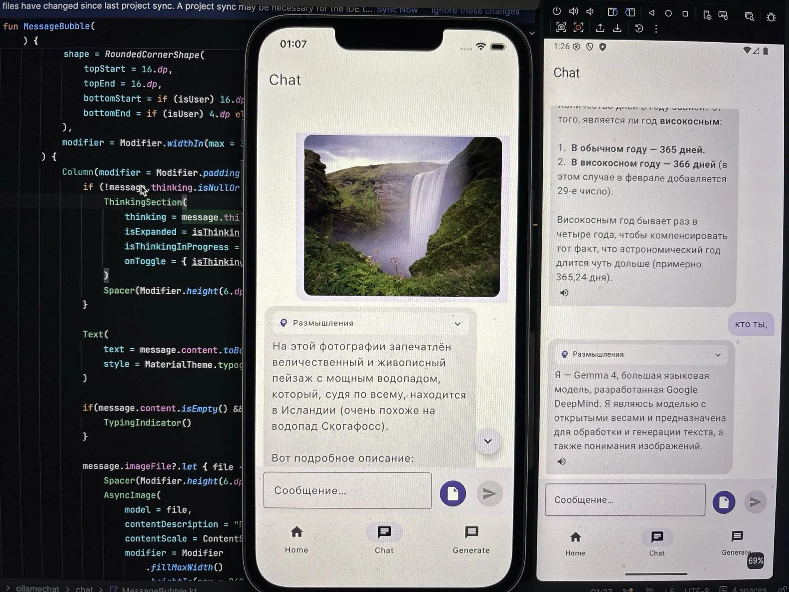

# OllameChat



## About the Project

**OllamaChat** is a modern, privacy-focused chat interface designed to interact with local Large Language Models (LLMs) via the **Ollama** API. Built with **Kotlin Multiplatform (KMP)**, it delivers a high-performance, native-like experience on both Android and iOS.

### Key Features

*   🤖 **Local LLM Chat:** Seamlessly connect to and chat with various models running locally on your machine through Ollama.
*   ⚡ **Real-time Streaming:** Enjoy instant, fluid, character-by-character response streaming for a natural conversation feel.
*   🧠 **Reasoning Support:** Specialized UI for "Thinking" processes, allowing you to follow the reasoning chain of advanced models like DeepSeek-R1.
*   🖼️ **Multimodal Capabilities:** Upload and send images to your models for advanced visual analysis and description.
*   💾 **Local Chat History:** All your conversations are stored securely in a local SQL database, ensuring your data stays on your device.
*   📱 **Cross-Platform:** One unified codebase powering high-quality apps for both Android and iOS using Compose Multiplatform.

## Building the Project

You can build the project using:

* **Android Studio:** Use the run configurations in Android Studio (Recommended for **Rabbit 2 | 2026.2.2 Patch 1**).
* **Command Line:** Run the following command from the project root:
  ```bash
  ./gradlew build
  ```

---

## Project Structure

```
.
├── androidApp/          # Android application
├── core/                # Core modules
│   ├── domain/          # Business logic and models
│   ├── network/         # Networking and API clients
│   └── storages/        # Local storage and databases
├── iosApp/              # iOS application
└── shared/              # Shared Kotlin Multiplatform code
    └── src/
        └── commonMain/kotlin/com/kmp/ollamechat/
            ├── App.kt            # Main entry point
            ├── chat/              # Chat UI and ViewModels
            ├── di/                # Dependency Injection (Koin)
            ├── home/              # Home screen
            ├── navigation/        # Navigation routes
            ├── settings/          # Settings screen
            ├── util/              # Utilities
            └── RootScreen.kt     # Root navigation screen
```


Learn more about [Kotlin Multiplatform](https://www.jetbrains.com/help/kotlin-multiplatform-dev/get-started.html)…
